# stenographr

Local speech-to-text for Linux: dictate into a clipboard or a Claude Code pane, keep notes, transcribe video clips. Nothing leaves the machine.

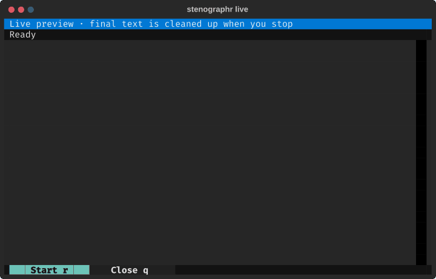

Engines: NVIDIA Parakeet TDT 0.6B v2 (int8) through [sherpa-onnx](https://k2-fsa.github.io/sherpa/onnx/) with Silero VAD;
the live preview uses the Nemotron streaming model. CPU or GPU.

## Install

```sh
uv tool install --editable .          # CPU only; `stenographr` lands on PATH
uv tool install --editable ".[gpu]"   # + CUDA 13 sherpa-onnx and NVIDIA libs (~1.6 GB of wheels, no sudo)
scripts/get-models.sh                 # VAD, Parakeet and the live-preview model into ~/.local/share/stenographr/models
```

`get-models.sh` is the only step that needs the network; it prints sizes, skips what exists and asks first (`DIR` = another
folder, `-y` = no question). Dictation needs `pw-record`, `ffmpeg` (libopus), `wl-copy`, `kitty` (for the shortcut) and `tmux` (Claude buttons).
The mic is a fixed PipeWire name, `scarlett-mic` ([docs/audio-setup.md](docs/audio-setup.md)).

## Quick start

```sh
stenographr live            # press Start (Enter), talk, Stop (s), Copy (y), paste anywhere
stenographr keybinding install   # Ctrl+` opens a popup that records at once
```

## live

A [Textual](https://textual.textualize.io/) screen. It shows each phrase as you speak (lowercase, no punctuation); when you stop it
re-transcribes the whole take for proper sentences. **Copy** puts the text on the clipboard (plus a trailing space), **Append** and **Send**
type it into the Claude Code pane of the tmux session. Only one instance records at a time; the model loads once per app.
It adapts to the pane size (a tall narrow sidebar works):

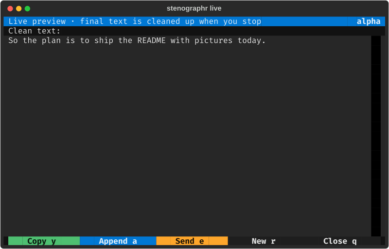

| | Ready | Recording | Review |
|---|---|---|---|
| 85x12 | 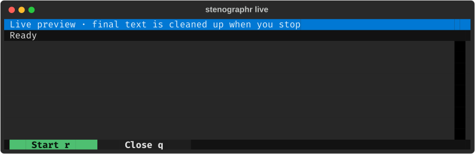 | 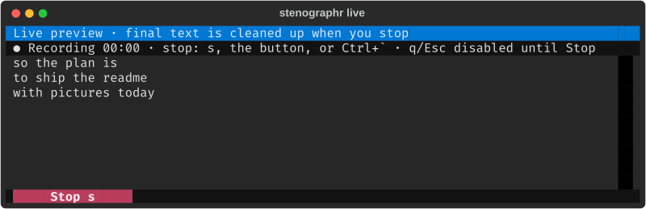 | 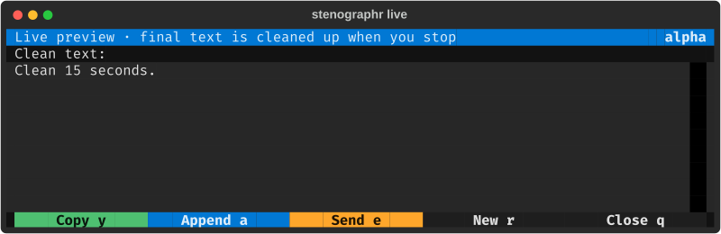 |
| 40x30 | 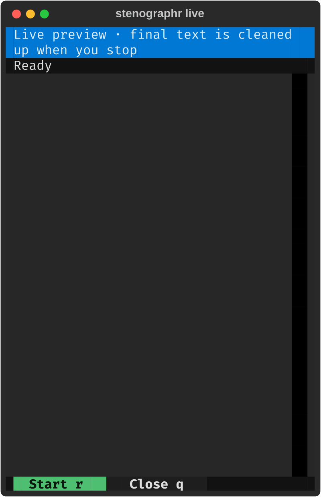 | 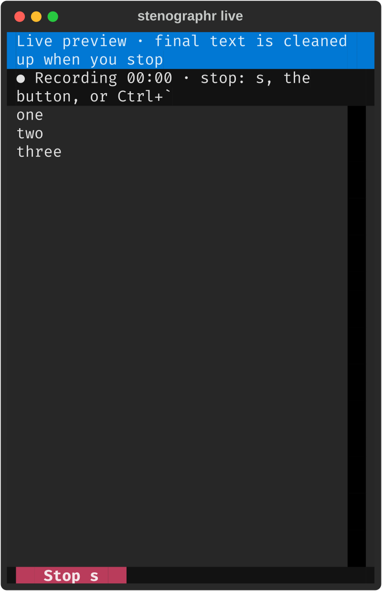 | 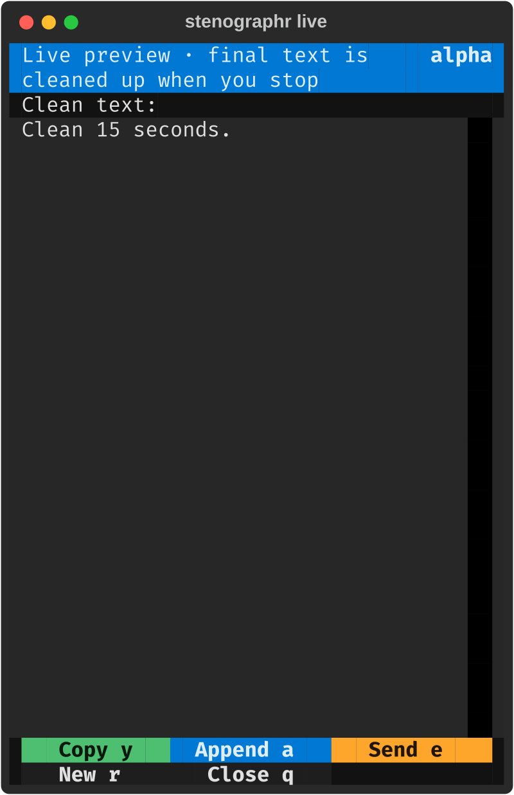 |

**Append** types the text and a space, no Enter, so you can add several takes. **Send** types the text and presses Enter.
**Send is the only place stenographr ever presses Enter.**

| after Append (text waits in the input) | after Send (submitted) |
|---|---|
| 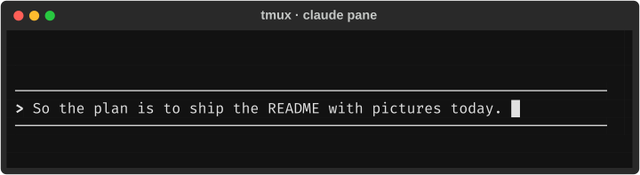 | 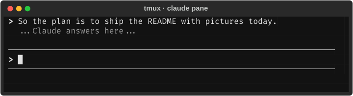 |

Every capture is a session block in the daily file with its audio (`<archive>/audio/*.opus`, never deleted). Details: [SPEC.md](SPEC.md).

## notes

`stenographr notes` (alias `steno`) dictates in the terminal until Ctrl+C: each sentence is printed and appended at once to
`steno-YYYY-MM-DD.txt` (in a git repo: `<repo root>/steno/`, added to `.gitignore`) and to the daily file. Timestamps go only into those files.

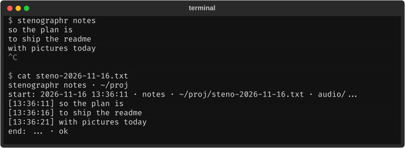

## recall

`stenographr recall [N]` lists the newest pieces of the day (sessions, clips) and copies the one you pick; `recall 2` copies piece 2.

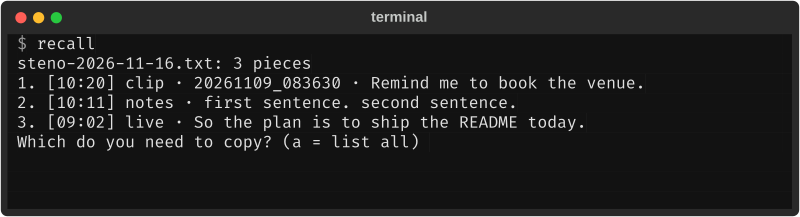

## clip

```sh
$ stenographr clip 20261109_083630.mp4
/home/me/videos/20261109_083630.txt
$ cat 20261109_083630.txt
# 20261109_083630 · recorded 2026-11-09 08:36 · 00:25:15
source: /home/me/videos/20261109_083630.mp4
engine: parakeet-tdt-0.6b-v2-int8 (gpu) · transcribed 2026-11-09 08:37

[00:00:00 → 00:00:03 | 08:36:30] Remind me to book the venue.
$ cat /data/transcripts/steno-2026-11-09.txt        # the daily manifest, one line per file
clip: 2026-11-09 08:37:05 · 20261109_083630 → clips/clip-2026-11-09-083630.txt
```

`--out DIR`, `--recorded-at "YYYY-MM-DD HH:MM"` and `--device cpu|gpu|auto` are optional. One transcript per video: if it exists the video is
refused with the `rm` to redo it (exit 1), nothing is overwritten. A video without audio gets `(no audio)`. The GPU is used only when it is free enough; otherwise CPU.

## srt

`stenographr srt FILE.txt` writes `FILE.srt` next to it (replacing an existing one; never automatic).

## keybinding

`stenographr keybinding install` adds the GNOME shortcut Ctrl+` = `stenographr live --toggle`; `remove` deletes only that entry.
It is global, so it takes Ctrl+` from apps that use it.

## Dictate from your phone

`stenographr phone` is a small web page for dictating on the phone: the note lands in the day's file and its audio in `audio/`, like laptop
dictation (mode `phone`). It listens on `127.0.0.1:3111` only; your phone reaches it over Tailscale, which provides the HTTPS that phones
require for the microphone. Tailnet only, never Funnel.

1. One time, if `tailscale serve` says access denied: `sudo tailscale set --operator=$USER`.
2. `stenographr phone --tailscale` runs `tailscale serve --bg --https=443 http://127.0.0.1:3111` and prints the phone URL
   (`https://<this machine>.<your tailnet>.ts.net/`). `stenographr phone --tailscale off` undoes it.
3. Start the server: `stenographr phone` in a terminal, or, to have it always running, `stenographr phone --install`
   (a systemd user service; `stenographr phone --remove` removes it).
4. On the phone (Tailscale on) open the URL, allow the microphone, tap **Record** / **Stop**; the optional title field becomes the note's
   `where` in the daily file. Add it to the home screen (browser menu: *Add to Home Screen*) to use it like an app.

The upload returns at once; the text appears in the page's list when the transcription is done (CPU, same engine as `notes`). The page keeps
the recording, retrying, until the server has saved it, even across a page reload. The original recording is kept as sent
(`audio/<start>-phone.webm` from Android, `.m4a` from iPhone). If the transcription fails the audio stays and the daily block says `FAILED`.
To have the service start without you being logged in, run `loginctl enable-linger $USER` once.

## update

`stenographr update` fast-forwards the source checkout (only a clean `main`), reinstalls if `pyproject.toml` changed, and lists the running
`live` instances to restart. It never stops them.

## Config

`~/.config/stenographr/config.toml`, every key optional:

```toml
[paths]
models  = "~/.local/share/stenographr/models"
archive = "/data/transcripts"
[engine]
name = "parakeet-tdt-0.6b-v2-int8"
[device]
device = "auto"            # `live` and `notes` default to cpu
[dictation]
mic = "scarlett-mic"
channel = 1
[phone]
port = 3111                # `stenographr phone`
max_mb = 200               # largest upload
```

## More

[SPEC.md](SPEC.md) (behaviour and formats) · [docs/DECISIONS.md](docs/DECISIONS.md) (why) · [docs/audio-setup.md](docs/audio-setup.md) ·
`bash tests/run-tests.sh` (offline; `hyperbeam lab run --why "stenographr tests" -- bash tests/run-tests.sh`) ·
`docs/make-media.sh` regenerates `docs/img` in the lab.
